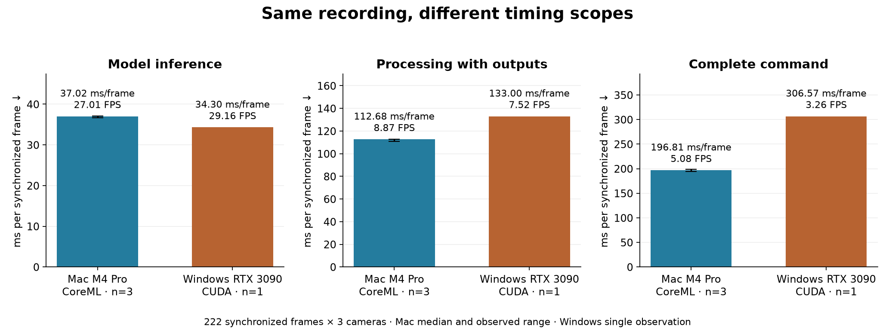

# Mac and Windows benchmark comparison — 2026-11-06

## Matched test-data results

Same input hashes and workload settings: 222 synchronized frames × 3 cameras (666 images), 1280×720, standard outputs. Mac M4 Pro / 24 GiB / CoreML: three runs. Windows i9-12900KF / RTX 3090 / 128 GiB / CUDA: one run from November 4. One frame includes all three camera images.

| Scope | Mac median | Windows | Mac time range (s) |
|---|---|---|---|
| Model inference | 37.02 ms/frame · 27.01 FPS | 34.30 ms/frame · 29.16 FPS | 8.149–8.240 |
| Processing with outputs | 112.68 ms/frame · 8.87 FPS | 133.00 ms/frame · 7.52 FPS | 24.627–25.037 |
| Worker incl. setup/checks | 169.77 ms/frame · 5.89 FPS | 252.30 ms/frame · 3.96 FPS | 37.205–38.233 |
| Complete command | 196.81 ms/frame · 5.08 FPS | 306.57 ms/frame · 3.26 FPS | 43.115–44.067 |

Mac inference throughput is 7.4% lower; session startup takes 4.45× as long. The complete Mac command is faster in these observations. These are different scopes, not contradictory results. Software revisions, cache and background load differ; this is not a controlled estimate of hardware effects.

## Tracking

| Operation | Mac seconds | Mac ms/frame · FPS | Windows seconds | Windows ms/frame · FPS |
|---|---|---|---|---|
| Video loading + tracking (includes session startup and inference) | 14.286 | 64.35 ms/frame · 15.54 FPS | 9.286 | 41.83 ms/frame · 23.91 FPS |
| Model inference (nested) | 8.219 | 37.02 ms/frame · 27.01 FPS | 7.614 | 34.30 ms/frame · 29.16 FPS |

## 3D reconstruction

| Operation | Mac seconds | Mac ms/frame · FPS | Windows seconds | Windows ms/frame · FPS |
|---|---|---|---|---|
| Match + triangulate | 0.377 | 1.70 ms/frame · 588.81 FPS | 0.719 | 3.24 ms/frame · 308.61 FPS |
| Filter trajectories | 0.009 | 0.04 ms/frame · 24642.37 FPS | 0.021 | 0.10 ms/frame · 10487.33 FPS |
| Align reference | 0.292 | 1.31 ms/frame · 760.81 FPS | 0.679 | 3.06 ms/frame · 326.90 FPS |
| Fit model dimensions | 0.074 | 0.33 ms/frame · 2992.61 FPS | 0.135 | 0.61 ms/frame · 1639.89 FPS |
| Reconstruct skeletons | 0.547 | 2.46 ms/frame · 405.89 FPS | 1.398 | 6.30 ms/frame · 158.80 FPS |

## Outputs

| Operation | Mac seconds | Mac ms/frame · FPS | Windows seconds | Windows ms/frame · FPS |
|---|---|---|---|---|
| Save observations | 0.251 | 1.13 ms/frame · 883.48 FPS | 0.563 | 2.54 ms/frame · 394.05 FPS |
| Save spatial data | 1.011 | 4.55 ms/frame · 219.54 FPS | 2.270 | 10.23 ms/frame · 97.79 FPS |
| Save recording | 0.726 | 3.27 ms/frame · 305.80 FPS | 2.079 | 9.37 ms/frame · 106.77 FPS |
| Annotate camera 0 | 3.508 | 15.80 ms/frame · 63.29 FPS | 5.341 | 24.06 ms/frame · 41.57 FPS |
| Annotate camera 1 | 3.470 | 15.63 ms/frame · 63.99 FPS | 5.343 | 24.07 ms/frame · 41.55 FPS |
| Annotate camera 2 | 2.445 | 11.02 ms/frame · 90.78 FPS | 4.131 | 18.61 ms/frame · 53.74 FPS |
| Blender export | 4.347 | 19.58 ms/frame · 51.07 FPS | 10.246 | 46.15 ms/frame · 21.67 FPS |

Spans can overlap (including annotation and nested inference). Do not sum these rows into a total or interpret reciprocal throughput as realtime capability. Per-call latency percentiles were not recorded.

## Setup and acceptance checks

| Operation | Mac median seconds | Windows seconds |
|---|---|---|
| Model/session startup | 5.942 | 1.335 |
| Calibration | 6.078 | 11.780 |
| Blender preparation | 1.459 | 3.513 |
| Numerical validation | 0.202 | 0.493 |
| Blender validation | 2.628 | 5.057 |

## Longer sample recording — Mac only

1,108 synchronized frames × 3 cameras; three successful runs. No matching Windows sample-data baseline exists.

| Scope | Median seconds | ms/frame · FPS | Seconds range |
|---|---|---|---|
| Model inference | 40.337 | 36.40 ms/frame · 27.47 FPS | 40.294–40.557 |
| Processing with outputs | 78.437 | 70.79 ms/frame · 14.13 FPS | 77.382–78.828 |
| Worker incl. setup/checks | 117.999 | 106.50 ms/frame · 9.39 FPS | 115.913–119.303 |
| Complete command | 126.428 | 114.10 ms/frame · 8.76 FPS | 124.162–127.793 |

## Physical camera recording health

1280×720, target 30 FPS (33.33 ms/frame), Python backend. Mac devices: A68-1600W and Global Shutter Camera. Windows devices: different USB Camera hardware. This compares recording conditions, not identical cameras.

| Machine | Configuration | Device slot | Measured | p99 interval ms | Missing frames | Case |
|---|---|---|---|---|---|---|
| Mac | A68 alone | camera[0] | 40.18 ms/frame · 24.89 FPS | 50.52 | 0 | failed |
| Mac | Global Shutter alone | camera[0] | 33.44 ms/frame · 29.90 FPS | 50.09 | 0 | passed |
| Mac | Both cameras | camera[1] | 40.14 ms/frame · 24.92 FPS | 67.07 | 0 | failed |
| Mac | Both cameras | camera[0] | 40.14 ms/frame · 24.92 FPS | 51.09 | 0 | failed |
| Windows | 1 USB camera(s) | camera[0] | 33.48 ms/frame · 29.87 FPS | 49.20 | 0 | passed |
| Windows | 2 USB camera(s) | camera[0] | 33.58 ms/frame · 29.78 FPS | 46.52 | 0 | passed |
| Windows | 2 USB camera(s) | camera[1] | 33.58 ms/frame · 29.78 FPS | 46.50 | 0 | passed |

### Suite outcomes

| Machine / suite | Python passed | Rust passed |
|---|---|---|
| Mac / extended | 16/23 | 0/23 |
| Windows / quick | 15/16 | 16/16 |

Suite totals are not matched workloads. Mac Rust failed all camera-open cases with “No cameras detected”. Python failures include A68 recording rate (alone and grouped), close-during-recording rate, backend change, both manual-exposure checks and repeated recording start. Recording frame numbers had no gaps in the cases above, but that does not make a below-target capture rate acceptable. 640×480 control transitions passed; 60/90 FPS modes were not exercised by this suite. Both test-managed servers exited cleanly.

## Evidence and reproduction

Core tested at `3ae9842d896085e7d05603e279fa0a53502122c1`, SkellyCam `f482a4fc11beacae4512e8290208a153fb6046c3`. Existing machine_benchmarks dataset/camera commands ran the existing processing and physical-camera harnesses. All six dataset runs passed numerical and Blender acceptance; Blender GUI opened and closed successfully. No dependency installation or environment refresh was performed. Shared desktop, AC power, cached models/managed Blender, fresh calibration each run. Full provenance and dirty-file inventory remain in source records.

JSON comparison contains source SHA-256 hashes and the existing comparison engine output. Every archived run includes the complete raw stage appendix.

- [2026-11-06-mac-mini-m4-pro-24gb-test_data-standard-01.json](results/2026-11-06-mac-mini-m4-pro-24gb-test_data-standard-01.json)
- [2026-11-06-mac-mini-m4-pro-24gb-test_data-standard-02.json](results/2026-11-06-mac-mini-m4-pro-24gb-test_data-standard-02.json)
- [2026-11-06-mac-mini-m4-pro-24gb-test_data-standard-03.json](results/2026-11-06-mac-mini-m4-pro-24gb-test_data-standard-03.json)
- [2026-11-06-mac-mini-m4-pro-24gb-sample_data-standard-01.json](results/2026-11-06-mac-mini-m4-pro-24gb-sample_data-standard-01.json)
- [2026-11-06-mac-mini-m4-pro-24gb-sample_data-standard-02.json](results/2026-11-06-mac-mini-m4-pro-24gb-sample_data-standard-02.json)
- [2026-11-06-mac-mini-m4-pro-24gb-sample_data-standard-03.json](results/2026-11-06-mac-mini-m4-pro-24gb-sample_data-standard-03.json)
- [2026-11-04-windows-rtx3090-standard-lifecycle-test-01.json](results/2026-11-04-windows-rtx3090-standard-lifecycle-test-01.json)
- [2026-11-06-mac-mini-m4-pro-24gb-cameras-extended-01.json](results/2026-11-06-mac-mini-m4-pro-24gb-cameras-extended-01.json)
- [2026-11-04-windows-rtx3090-cameras-quick-01.json](results/2026-11-04-windows-rtx3090-cameras-quick-01.json)
