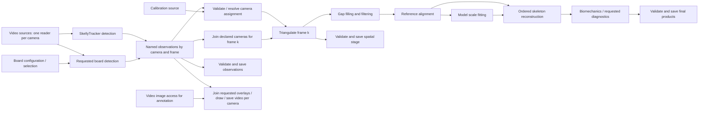

# Posthoc graph: sources to sinks

2026-10-11. Implementation plan, not an implemented runtime. This consolidates
the owner's decisions in [foundations](dataflow-foundations.md) and the
[operation audit](operation-readiness-inventory.md). Work stays in the isolated
worktree. Keep realtime unchanged and retain the current posthoc route for
separate parity/performance comparisons. Scientific validity is mandatory.

Implementation progress: `freemocap/core/pipeline/dataflow/` now contains immutable,
JSON-serializable graph definitions, a structural compiler and a single-owner camera
join contract. The compiler validates ports, semantic compatibility, scope bindings,
required inputs and cycles. The join separates eager frame readiness from successful
producer completion and rejects foreign/duplicate data and terminal outcomes.
This is not yet a scheduler, image store, transport adapter or real processing route.
Join coverage bookkeeping retains frame identities for the declared recording;
large-recording memory measurements and compact coverage storage remain future work.
The dataset `graph` implementation selector still correctly rejects execution.

Source implementation progress: `dataflow/video_sources.py` now resolves existing
recording video associations and timing, validates full equal coverage, and starts
one managed sequential reader thread per camera. `ConcurrentVideoSources.events()`
yields `LoadedVideoFrame` and `VideoSourceFinished` to a backend consumer through
bounded per-camera thread queues. One camera failure does not cancel the others. This is
a source adapter, not a graph executor. Image arrays are owned, read-only thread
data; shared-memory fan-out remains unimplemented. Queue
capacity bounds queued events per camera, with up to one additional image per reader plus
whatever the consumer retains. Native decoding cancellation is cooperative.

2026-10-11 loading-only diagnostic, one run per existing reference recording:

| Recording | Coverage | Reader lifecycle wall time | Camera images/s |
| --- | --- | --- | --- |
| Test data | 3 cameras × 222 frames | 0.725 s | 918.45 |
| Sample data | 3 cameras × 1,108 frames | 3.642 s | 912.61 |

All six source outcomes succeeded. Timing covers reader startup, decoding, event
consumption and shutdown, excluding metadata/timing resolution, tracking and
scientific output processing. Cache state was uncontrolled; these are single-run
source diagnostics, not paired end-to-end performance claims. Ignored report:
`.test-artifacts/source-tests/source-loading-report.json`. Tests additionally
exercise forced overlapping reads, isolated early EOF, equal-count rejection,
range rejection and early consumer exit. No existing pipeline was switched over.

Tracker integration progress: `dataflow/tracker_adapter.py` now implements
`SkellyTrackerAdapter.track_recording(...)`, yielding `TrackedCameraFrame` or
`VideoSourceFinished`. It uses the existing session-request factory and inference
service, one active batch and two queued frames per camera by default. Readers
may additionally hold one frame while waiting to enqueue. This bound excludes
decoder internals, model tensors and data retained by callers. The adapter never
accumulates a recording of images. Read-ahead uses independently drainable queues
and `read_camera_event(camera_id)`, avoiding a shared-FIFO batch-assembly deadlock.

Inference cancellation is client-local. Source failure removes only that source
from later tracking batches; it does not change the declared scientific camera
join or authorize reduced-camera triangulation. Installed ONNX `run_batched`
accepts a variable camera dictionary and warns on configured batch-size mismatch;
specific GPU model/provider behavior with reduced batches remains to be validated.
Opaque inference errors raise, without automatic retry or invented per-camera
success. The shared inference service is application-owned. Reader workers use a
dedicated registry because the existing registry's public reaping API is global
to that registry, not scoped to a supplied worker list. Realtime is unchanged.

Validation: 42 focused tests passed, including six adapter tests. The real
SkellyTracker integration test uses its installed CPU ChArUco detector/session pool
on generated video files. Controlled detector tests establish read/inference overlap,
bounded read-ahead, source-failure isolation, cancellation and early close. This is
not yet RTMPose/CUDA validation, a parity result, a generic graph executor, or HTTP
integration. The graph execution selector remains unavailable until acceptance and
the complete route are implemented. Backend iterator consumption must never be
driven by WebSocket client acknowledgements.

## Starting from the actual application

| Existing capability | Reuse / new responsibility |
| --- | --- |
| `freemocap/core/pipeline/posthoc/video_group_helper.py` | Reuse source associations, metadata and equal-frame-count validation. Do not silently truncate to the shortest video. |
| SkellyCam `SequentialVideoReader`, already used by `mocap_video_node.py` | Reuse sequential BGR loading; give each reader one owner. |
| `freemocap/core/reconstruction/recording_timing.py` | Reuse recorded camera/group timestamps and existing fallback rules. Preserve timing provenance. |
| `freemocap/core/pipeline/inference_service.py` and `freemocap/core/tracking/tracker_factory.py` | Reuse tracker/session construction and supported camera batching; preserve camera-specific tracker state. Current service permits one outstanding request/client, so do not promise arbitrary concurrent GPU calls. |
| Camera matching, triangulation and reconstruction modules | Reuse scientific algorithms through explicit graph operations, not an old-coordinator wrapper. |
| Recording descriptors, sample validation and saved-stage processing | Reuse scientific identities, accepted formats and restart validation. Separate numerical handlers from orchestration where necessary. |
| Existing worker registry, pubsub, HTTP/WebSocket and dataset tooling | Adapt these services; do not create a second application or benchmark framework. Verify transport guarantees before use. |

Current detection already overlaps next-frame reading with camera-batched
inference. Its loop then waits for annotation commands, which also perform board
detection, before yielding observations. The new graph separates these scientific
results from drawing/encoding. This is a coordination change, not replacement of
SkellyTracker's numerical algorithms.

## Base ontology

Naming convention: prefer specific, explanatory names, generally two words or
more, over generic single-word abstractions. Names should make sense outside the
implementation and reduce collisions. The code uses `DataGranularity` (the unit
one data item represents), `DataContract`, `GraphNode`, `GraphPort`,
`GraphConnection`, `PortReference`, `InputBindingRule`, `ProducerOutcome` and
`CameraFrameJoin`. Data granularity is not worker placement or a scheduling barrier.

| Term | Meaning in this design |
| --- | --- |
| Graph definition | Immutable operations, typed ports, connections and declared requirements for one configured task. |
| Node | One operation definition; may have many camera/model/frame work items. Not synonymous with a worker. |
| Port | Named input or output with a semantic data contract: payload kind, identity axes, units/reference frame where applicable, and delivery/coverage requirements. |
| Edge | Output-port to input-port binding with an explicit matching rule: same camera/frame, all declared cameras for a frame, broadcast configuration, or declared collection coverage. |
| Source | Supplies external data: videos, timing, calibration, configuration or validated saved results. |
| Sink | Performs an external effect, such as saving or reporting. Scientific work does not depend on annotation/display completion. |
| Work item | One invocation identified by execution, operation and applicable camera/group/frame/model partition. |
| Execution | One running instance, with fixed scientific configuration and its own state; distinct from a saved run ID. |
| Stage | Validated durable restart boundary, not a global scheduling barrier. |
| Ready | Required data and state predecessors are satisfied; resource capacity governs dispatch. |
| Complete | Declared coverage and all required dependency outcomes succeeded; eager intermediate work alone is insufficient. |

Optional means configurable before execution. Once selected, that dependency is
required for its product. Successful empty detections remain data; failure and
missing delivery are different states. Types include named point/model identity,
coordinate frame and units, not merely array dimensions.

## Sources and timing

Resolve a recording before scheduling frames:

```python
recording = resolve_recording(path, requested_work)
videos = resolve_video_associations(recording)
validate_unique_sources_and_equal_frame_counts(videos)
coverage = full_selected_frame_range(videos)  # no artificial frame cap
timing = resolve_existing_recording_timing(recording, videos, coverage)
geometry = load_calibration_if_required(recording)
graph = compile_graph(requested_work, videos, coverage, timing, geometry)
```

These are illustrative interfaces. Source metadata establishes expected coverage;
actual reading must detect early EOF/corruption rather than treating it as success.
Use recorded timestamps when available and the existing video-metadata fallback
otherwise. Preserve whether timing was measured or estimated.

Posthoc loading needs no wall-clock synchronization or playback-rate sleeps.
Readers advance independently. Corresponding recorded frame ordinals establish
joins within the validated synchronized group, regardless of arrival order.
Equal frame counts establish compatible coverage, not proof that arbitrary videos
were physically synchronized. Retain the recording's synchronization assumptions
and timing checks; do not silently resynchronize, drop, pad or interpolate frames.

Conceptual payloads reference existing scientific types:

```python
FrameKey(recording, sensor_group, camera_source, frame_number)
Frame(key, timestamp, timing_method, image_handle)
TrackedFrame(key, tracker_identity, observation)
BoardFrame(key, board_identity, observation)
GroupPoints(group_frame_key, point_names, reference_frame, units, points)
```

Execution identity accompanies delivery so stale events cannot join a new run.
Image handles refer to owned storage, not image bytes serialized into pubsub.

## Source-to-sink structure



This is a mid-level sketch, not the full port schema. Compile away unrequested
branches. Alignment also consumes raw evidence and geometry; reconstruction and
filtering consume timing/model configuration. Saved-stage sources replace eligible
upstream operations through existing provenance validation. No save arrow feeds
the next numerical operation during a continuous run.

Camera assignment currently samples the entire recording. Preserve that evidence
requirement: triangulation can run eagerly once assignment and matched inputs
exist, but cannot claim readiness before then. Future-data filtering, alignment
and scale fitting similarly declare their actual evidence needs. A new scheduler
does not make these algorithms frame-local. Single-camera projection is a separate
operation, not a degenerate claim of metric multicamera triangulation.

## Concurrency and delivery

### Tracker adapter reuse audit — 2026-10-11

Inspected the installed SkellyTracker `Tracker.process_batch` and
`SharedSessionPool.create_tracker` implementations [@skellytrackerBatchSessions2026],
core's `tracker_factory.py`, `inference_service.py`, and its tests. The installed
dependency's recorded Git revision matches `uv.lock`:
`2b7c047c272506eefbac5a2f0805bced2d20525f`. This checks package provenance against
the lock, not whether the remote branch has advanced.

- Reuse `tracker_session_requests` for detector registrations and model/backend
  resource descriptions. Do not add another model/session factory.
- Reuse `InferenceService` / `InferenceClient` and SkellyTracker's shared session
  pool for owner-thread lifetime, leases, request completion and per-camera state.
  `Tracker.process_batch` already performs camera batching for ONNX detectors and
  uses thread-pool execution for non-ONNX detectors. Do not wrap it in another
  per-camera inference pool or reproduce preprocessing/postprocessing.
- The graph adapter owns identity validation, bounded admission/batch assembly,
  image lifetime until the inference future is terminal, and observation routing.
  It does not own detection algorithms, model weights or scientific state updates.
- One request uses one frame ordinal, and posthoc ordinals must be consecutive
  from zero. The service allows one outstanding request/client, and does not merge
  requests across clients. Preserve these constraints during initial integration.
- The service marks its client's shutdown flag on inference failure. Give the
  adapter a client-local flag rather than reuse the entire graph's cancellation
  flag. A batch-level inference failure is not proof of which camera failed;
  never invent individual successful results or unsafe stateful retries.
- A camera source failure and inference failure are different. Continuing healthy
  cameras after source failure may require smaller supported batches; verify model
  session batch handling before enabling that behavior. The scientific join still
  requires the original declared camera set and cannot accept reduced-camera output.
- Source queue bounds alone do not bound unmatched frames in the adapter. Add
  per-camera admission/credits or independently drainable camera buffers before
  integration. Simply ceasing to drain a shared FIFO when a fast camera is ahead
  can trap a needed slow-camera frame behind it and deadlock batch assembly.

Existing inference-service tests were rerun: 8 passed, including isolated clients,
state retention, cancellation, scheduling fairness, and installed CPU session pool
integration. These tests do not establish GPU execution or numerical parity. Next
adapter tests must prove bounded memory under camera skew, first inference before
reader completion, correct release on cancellation, and failure isolation.

Start with managed threads for video reading and non-camera-capture work. Each
video reader is sequential internally; different readers overlap. Tracker state
is partitioned by camera and execution, respecting model ordering requirements.
Use SkellyTracker's supported batching and session machinery. Record actual
provider, model, batch size and measured execution; requesting GPU is not evidence
that GPU execution occurred. Do not alter realtime service semantics incidentally.

```python
on_result(result):
    validate_and_store_by_identity(result)
    for consumer in consumers_of(result.port):
        for key in consumer.newly_satisfied_keys():
            ready_queue.offer(consumer, key)

dispatch_ready_work():
    # Fair bounded dispatch; never wait here for an encoder or browser.
    for item in resource_policy.admit(ready_queue):
        workers.submit(item, completion_callback=on_result)

on_terminal_outcome(producer, outcome):
    record_coverage_and_outcome(producer, outcome)
    mark_unsatisfiable_dependents_without_cancelling_independent_work()
    reconsider_collection_readiness_and_sink_acceptance()
```

No single frame loop waits for all operations to finish before admitting the next
frame. Resource bounds may limit read-ahead; stateful operations may require prior
frames. Those waits must be attributable to resource/data/state requirements.

Use explicit reliable completion/failure delivery for scientific work. Existing
pubsub's lossy paths are unsuitable without an adapter; an empty queue is not EOF.
Use bounded image storage with explicit release responsibility after consumers
finish; process placement requires appropriate shared-memory ownership. Current
shared rings are not automatically safe multi-consumer leases.

Annotation joins requested overlays per camera/frame, draws all of them and writes
in order. Keep its image access independent of scientific buffer release, using
re-reading or private temporary storage as appropriate. Slow encoding must not
hold scientific producers hostage. Retain valid partial videos as explicitly
incomplete diagnostics when possible. Do not invent missing overlays.

Accepted scientific saves require complete declared coverage and scientific
validation, including camera-assignment evidence. Intermediate private files are
allowed. If a camera fails, discard incomplete scientific products from acceptance;
continue satisfiable branches. Report partial failure, not global success.

## Server and inspection

Use the application's HTTP boundary to configure/start/control execution. Backend
execution owns its lifetime independently of browser connections. WebSocket sends
self-describing backend state; no client acknowledgement releases scientific work.
Keep reporting off the critical path with bounded/coalesced progress snapshots;
preserve authoritative outcomes server-side for reconnect and final reports.

Export the compiled graph's ports, connections and partition descriptions to the
viewer. Generate transport schema from those definitions. Display per-camera
progress and explicit wait reasons; do not author a second semantic graph in UI
code. Track handler time, queue/resource wait, counts, actual batches/providers,
buffer high-water marks and sink outcomes. Browser absence or slowness is a test
case, not an execution prerequisite.

## Implementation stages

1. **Contracts and compiler.** Add a small posthoc graph package with typed ports,
   identity/coverage, operations and validated bindings. Test invalid connections,
   missing configured inputs and frame/camera joins. No general-purpose framework
   features without a concrete pipeline need.
2. **Real sources through tracking.** Adapt existing video/timing/session machinery.
   Run full reference recordings, save observations through existing acceptance,
   and measure camera concurrency/provider/batching. Test early EOF and preserve
   per-camera state. This is the first end-to-end implementation slice.
3. **Scientific graph and independent annotation.** Add matching, triangulation,
   trajectory/model operations and annotation as declared operations. Implement
   completion/failure propagation and temporary/accepted sink boundaries. Test a
   failed camera, slow encoder and requested board-plus-skeleton overlays.
4. **Application control and graph inspection.** Integrate existing HTTP/WebSocket
   services and the thin generated graph view. Verify disconnect/reconnect and
   stalled reporting cannot stop execution.
5. **Parity and performance gate.** Extend the existing dataset implementation
   selector with the real graph route. Run current/graph separately on identical
   input/configuration/calibration into separate destinations. Validate each,
   compare scientific keys, masks and numerical values with justified tolerances,
   then report throughput, waits, memory and output coverage. Keep realtime untouched.

Steps 2–5 incrementally use the reporting foundation already added to
`freemocap.tools.datasets`. Historical reports are context, not a fresh benchmark.
No speedup is claimed until measured. A regression in scientific behavior blocks
acceptance regardless of speed. Human review owns later cutover and Git changes.

## Tracking-boundary validation implementation

`SkellyTrackerAdapter.track_recording` now connects the bounded, per-camera
threaded readers to the existing `InferenceService`. It passes owned in-process
image arrays into SkellyTracker's camera batch API and retains per-camera temporal
state. This remains a backend iterator; the future graph executor must own its
consumption independently of the viewer. No production HTTP route has been switched.

The dataset tools now include `tracker_comparison` (one detector/backend) and
`tracker_matrix` (isolated subprocesses for the supported suite). They compare
complete observation trees, camera/frame identity, original camera timestamps,
point names, missing-value masks and coverage; report setup/inference/wait timing;
and verify requested ONNX provider registration. Their baseline is the existing
inference service plus sequential video reads, not the old full coordinator.
See [dataset tool commands](../../freemocap/tools/datasets/README.md#tracker-adapter-parity-and-timing).

The MediaPipe test uncovered a scientific reproducibility problem: without an
explicit timestamp, its video detectors fall back to processing wall time.
Changing the loading schedule therefore changes temporal results. The graph
adapter now supplies relative recording-group milliseconds, using the established
recorded-or-FPS-inferred timing resolver; original camera timestamps remain on
results. Millisecond collisions are rejected. The shared inference request's new
timestamp is optional, so existing realtime/current callers retain their behavior.
The comparison supplies the same explicit timeline to both paths. This is a
deliberate temporal correction, not a claim of parity with the old fallback
[@skellytrackerBatchSessions2026].

Default ChArUco CPU, MediaPipe CPU, RTMPose CPU and RTMPose CUDA configurations
are exercised. MediaPipe CUDA is explicitly unsupported by the installed detector
implementation; an environment flag or successful session probe is not GPU
execution evidence. Changes to expose another delegate belong in an independently
reviewed SkellyTracker change. ONNX provider evidence also does not certify that
every kernel ran on CUDA.

Same-backend parity, CPU-versus-CUDA differences, and scientific acceptance are
separate questions. Diagnostic arrays are not accepted recording products. This
slice does not yet certify saved 2D/3D products, annotations or the full posthoc
graph. Wall times include asymmetric diagnostic I/O and fixed baseline-first
setup effects; performance acceptance still needs repeated, symmetric measurement.

## Raw scientific slice — 2026-10-11

`dataflow/scientific_recording.py` now owns camera/frame observation collection,
eager all-camera frame triangulation and completion-gated canonical saving. It
reuses the existing camera matcher, triangulator, coordinate conversion and writer.
The numerical helper has an additive explicit point-name axis for incremental
calls. No realtime route or production posthoc selector has been replaced.

There are two explicit input paths: automatic matching needs the existing
recording-wide evidence before geometry is resolved; previously resolved assignment
can triangulate during tracking as each complete camera/frame join becomes ready.
Tests demonstrate first-frame computation before iterator exhaustion, late camera
failure invalidating completion, healthy-camera draining, numerical parity including
outliers/missing detections, canonical raw-3D save/read-back, and rejection of changed
scientific payloads. This is an executable backend slice, not a completed generic
graph scheduler or HTTP/WebSocket integration.

Real RTMPose CUDA-requested recordings (3 x 222 and 3 x 1108 frames) passed the
incremental-versus-batch solver comparison: largest position differences were
4.84e-13 and 1.37e-12 respectively, with matching missing-value masks. Initial
tracking/matching/incremental-solver durations were 12.61 s and 72.32 s; the small
reviewed rerun took 20.35 s. These are single diagnostic executions, not speedup
benchmarks or evidence of stable throughput. The separate batch solver measurements
are not equivalent to end-to-end old-pipeline times.

Initial real-data scientific saves were rejected because matching returned `poor`.
The reviewed small run retained original camera order, but two cameras exceeded
the configured 5 normalized-pixel p90 threshold (approximately 5.65); median errors
remained below 2. Units are pixels at a 1000-pixel image diagonal, not native image
pixels. This is not proof of a wrong assignment. The extra sink rejection was a
policy bug: it overrode the existing posthoc `continue` policy. Computation and
saving now share `require_processing_assignment`, preserving the established policy
and unchanged fitness diagnostics. Strict `stop`, absent assignment, and incomplete
required cameras still prevent saving. Saved tracker metadata includes the fitness
status, camera mapping, per-camera measurements and their units. No numerical
thresholds, sampling choices or reconstruction algorithms were changed.

The corrected policy passed both complete reference recordings (3 x 222 and
3 x 1108 frames), including canonical save and exact raw-3D read-back. Matching
status remained `poor` in the on-disk metadata; source mapping and per-camera
fitness were also read back and checked. Numerical differences versus the existing
batch solver remained at most 4.84e-13 and 1.37e-12. Reports are retained locally in
`.test-artifacts/scientific-slice/{test,sample}-policy-validated/report.txt` and
`report.json`. Focused validation passed 55 tests; the save tests additionally
exercise persisted warning metadata, strict stopping and absent assignments.

Root cause: a second, unconfigured fitness gate at the new sink contradicted the
established posthoc policy documented in `camera-geometry-matching.md`. Fitness is
a diagnostic of sampled observations against geometry, not proof of camera identity
or an independent binary certification of an entire dataset. Sharing the continuation
check and retaining the diagnostics prevents that policy drift from recurring.

Next: integrate whole-recording filtering/alignment/reconstruction with their real
dependencies and canonical stage completion. Extend detector coverage downstream,
and only then compare complete old/new execution routes with symmetric timing.


### Complete recording milestone

The first complete backend recording graph is now implemented; see
[full-recording-loop.md](full-recording-loop.md) for contracts, validation evidence
and remaining integration work. It adds existing filtering, alignment, recording-wide
model fits, skeleton reconstruction, independent annotation sinks and canonical saves.
It remains a backend experiment alongside production, with explicit recording-level
barriers where the reused algorithms require complete evidence.
