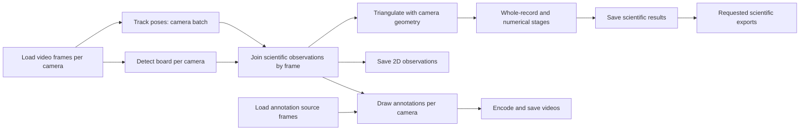

# Typed executable dataflow for FreeMoCap

Start with the [source-to-sink implementation plan](source-to-sink-plan.md)
for the current mid-level design and staged implementation sequence. It incorporates
the subsequent owner decisions; older proposals below remain subject to those decisions.

See [dataflow foundations](dataflow-foundations.md) for cited intellectual context,
working terminology and decisions settled after this proposal was drafted.
The SkellySpeak reference is registered as [@skellyspeakGraph2026].

Status: proposed design, 2026-10-10. No replacement runtime implemented here.
This supersedes the October 5 graph proposal for new development. The
`experiments/executable_graph_lab` work remains parked. The intended destination
is the application's existing HTTP/WebSocket architecture, not another lab server.

## Scope and authority

Owner update, 2026-10-11: leave realtime execution unchanged. Build a separately
selectable posthoc graph execution path alongside the current posthoc path in the
isolated worktree. Retain both during numerical parity and performance validation;
this supersedes any earlier immediate-removal requirement. Selection occurs at the
application boundary, not through an opaque old-pipeline node inside the new graph.
Benchmark paths in separate runs against identical immutable input/configuration
and separate output destinations; concurrent comparison runs would confound resource
measurements. Removal of the existing path follows evidence and a later cutover
decision, not initial implementation. Do not alter shared inference behavior for
realtime as an incidental part of the posthoc work.

The owner requires strict executable graph definitions, a visualization derived
from those definitions, independent server execution, and measurable comparison
with the current posthoc pipeline. Realtime should eventually share the language,
but its scheduling and loss policies are outside the first implementation.

The module boundaries and protocols below are proposals. Existing scientific
models, recording identities, checkpoint provenance, and saved-stage restart
rules remain authoritative. Follow [the recording contract](../../RECORDING_CONTRACT.md)
and coordinate with [ongoing export work](secondary-exports.md). Do not replace
that work with a second persistence format. Cutover removes the old coordinator;
there is no production legacy-wrapper node or permanent dual execution path.

## What the source inspection establishes

SkellySpeak reference: sibling `other/skellyspeak`, inspected October 10 at HEAD
`e84b44e2c4d3682d8ba4eb9a925ed713f092e61a`, with ongoing uncommitted agent work.
These are source observations, not a pinned release or independently rerun tests.

| SkellySpeak source | Transferable idea |
| --- | --- |
| `docs/notes/ai-graph-foundations.md` | Finite typed dependency DAG; explicit activation, readiness, authority, attempts and adoption. No unsupported determinism claim. |
| `native/src/ai/graph/model.rs` | Versioned contracts, typed ports, explicit absence, node occurrences distinct from operations. |
| `native/src/ai/graph/compile.rs` | Compilation binds validated structure to implementations; execution validates inputs and outputs against that artifact. |
| `native/src/ai/graph/projection.rs` | Inspection exposes the compiled artifact plus runtime facts. |
| `ui/src/generated/graph-contracts.ts` | TypeScript generated from native types, including structural and runtime contracts. |
| `ui/src/features/activity/native-graph-layout.ts` | Generic layout reads actual bindings, controls, guards and boundaries. Attempts do not invent topology. |
| `ui/tests/architecture/ai-graph-source.test.ts` | Guards against a second operation/dependency catalog in the UI. |

The chat **Fix AI activity graph structure** is still validating scheduler,
storage and reporting performance. Borrow its semantics and projection strategy;
do not treat its current performance as a proven baseline for video processing.

Verified current FreeMoCap behavior (paths relative to `freemocap/`):

| Source | Finding and consequence |
| --- | --- |
| `core/pipeline/posthoc/mocap_detection.py` | Camera reads are dispatched together; next-frame reads overlap current inference. The coordinator then waits for every `AnnotateFrame` result before advancing. This is partial concurrency with a real barrier, not wholly serial loading. |
| `core/pipeline/posthoc/mocap_video_node.py` | A camera thread owns loading, board detection, observation mutation, drawing and encoding. Removing the wait without separating board results would change scientific outputs. |
| `core/pipeline/inference_service.py` | One outstanding request per client, ordered posthoc ordinals, shared model lifetime, and bounded realtime preference. More graph workers do not automatically create more GPU capacity. |
| `core/pipeline/posthoc/mocap_pipeline.py` | Observations accumulate before subsequent scientific processing; requested exports run after saved processing. Preserve their outcome semantics. |
| `core/pipeline/posthoc/stage_dependencies.py`, `stage_execution_plan.py` | Existing prerequisite closure, checkpoint reuse and invalidation must survive migration. |
| `api/http/mocap/mocap_router.py`, `app/app.py` | HTTP already launches processing; an application background collector refreshes progress even with no connected client. A separate browser is not itself proof of execution isolation. |
| `core/pipeline/performance_report.py` | Existing bounded timing summaries distinguish coordinator waits and worker work. They overlap and are not GPU kernel timings. Extend this evidence rather than discard it. |

This audit does not establish the current machine's active GPU provider or a
measured speedup. Those require a recorded execution, provider evidence and a
controlled baseline. Historical screenshots do not answer either question.

## Formal vocabulary

**Contract**: a versioned payload identity plus validated structure and semantic
constraints, including units, coordinate conventions and key meaning where relevant.

**Operation**: a reusable computation with declared input/output ports, implementation
identity, effects, ordering and resource requirements.

**Node**: one occurrence of an operation in a graph. It is not a worker, process,
camera, invocation or model session.

**Port**: a named typed input or output endpoint. Its delivery protocol and
cardinality are part of its contract. Optional means explicit absence is allowed;
unbound, not yet available, empty detection, failure and absence are different.

**Binding**: an explicit producer-output to consumer-input connection with a key
mapping and collection rule. Matching types permit a binding; they do not create it.

**Source / sink**: boundary roles for acquiring data and delivering effects.
Loading a video is a source; saving results is a sink. Configuration is a bound
value, not a fictitious processing node. Resource acquisition has a lifecycle,
not a pretend scientific data product.

**Partition**: an independently ordered subset of work, such as one camera.
**Firing**: one invocation for a particular key. **Attempt**: one execution try
of that firing. **Executor**: the mechanism that runs attempts on allocated resources.

**Artifact**: the immutable compiled graph with resolved operations, bindings,
contract versions and implementation identities. Scientific output artifacts are
separately identified; they are not the executable graph artifact.

**Execution run**: one operational execution of an artifact. It is distinct from
the retained scientific run ID and recording revision in the recording contract.

## Static graph and repeated execution

Define a graph as `G = (V, O, I, U, B, C, A)`: node occurrences, their resolved
operations, graph input/output boundaries, data bindings, explicit control
dependencies, and activation/guard policy. Nodes own their ports. Compilation
validates acyclicity across data, control and guard dependencies together.

Each input has exactly one declared binding, constant, or explicit absent value.
Collection inputs have one explicit join/collection binding; multiple producers
are never silently merged. Contracts initially match exactly. Conversions require
an operation. Compiler errors identify node, port and incompatible contract.
Validate unique identities, referenced ports, handler availability, configured
partitions, key transforms, join coverage, effect ownership and resource policies.
Validate file locations through the recording contract, not a viewer path table.

A finite topology can execute many keyed firings. Do not expand every frame into
the artifact. A firing key contains execution, node, sensor group, synchronized
ordinal and applicable camera/trajectory partition. Preserve existing timestamps
and source identities; do not substitute filename order for synchronization.

FreeMoCap needs an explicit stream extension beyond a completed-value DAG:

* A value binding supplies an immutable value once, possibly to many firings.
* A keyed stream supplies typed items with declared ordering, termination and
  failure semantics. A terminal seal records completed coverage; silence is not EOF.
* A camera join requires the declared set of camera results for the same key.
  A valid empty detection satisfies its input; a missing frame does not.
* A sealed collection supplies a whole trajectory/recording to an operation that
  genuinely requires global context. It may reference on-disk storage.

Posthoc delivery is lossless. Duplicate keys are rejected unless they are an
identified replay of the same accepted result. Missing keys at seal fail with
specific diagnostics. A retry cannot apply state transitions or save effects twice.
Stateful handlers require partition ordering and an explicit restart/checkpoint
policy; arbitrary frame parallelism is not valid for all trackers.

Readiness means all required inputs for a firing are available. Admission also
requires authority, an unpaused run and resource capacity. Report those separately.
Reserve the full required resource set atomically before dispatch; never hold a
GPU slot while waiting for an input or output buffer. Release on every terminal path.

## Intended posthoc composition

The following is an explanatory proposal, not an independently authored runtime
topology. Production inspection must instead come from the compiled artifact.

Board selection, geometry and timing are declared inputs/dependencies, not hidden
reads. Board selection may itself require a discovery operation; preserve its
selection semantics before attempting parallelization. A task without board
tracking resolves without that required join input. Annotation has no outgoing
scientific dependency. Requested annotation/export failures remain visible in
the overall outcome even when scientific results have already been saved.

Initial annotation proposal: a separately ordered source reader consumes the same
video and keyed saved/buffered observations. This avoids retaining scientific pixel
buffers until a slow encoder catches up. Measure the extra read cost. Any alternative
shared-frame fanout must declare bounded storage or spooling and its pressure policy;
a lossless slow consumer cannot be both unbounded and free of backpressure.

Filtering, fitting and reconstruction must be mapped against their actual input
requirements. Do not claim every downstream step is framewise. Explicit barriers
for trajectory filtering or recording-wide fitting are legitimate dependencies.

## Deep module boundaries

The proposed graph core exposes compile, submit, control and inspect interfaces.
It owns contract validation, keyed readiness, bounded admission, lifecycle and
causal runtime facts. It knows nothing about FastAPI, React or recording folder layouts.

FreeMoCap composition owns scientific adapters, stage reuse/invalidation, recording
leases, output transactions and the shared inference-service integration. Handlers
receive declared data and explicitly owned resource capabilities. They must not
invoke downstream handlers or conceal a pipeline inside a generic operation.

Executors own threads/processes/device sessions. Nodes do not imply one process each.
Choose boundaries from measured GIL, copying, memory and device behavior. Preserve
the existing shared inference owner initially; benchmark any proposed replacement
separately rather than bypassing its fairness and session-lifetime policies.

Output sinks have explicit ownership and temporary/final paths. A scientific result
becomes reusable only after successful validation and recording-contract publication.
Do not promise exactly-once external effects after a crash; use idempotent destination
identity and reconcile interrupted attempts. Cancellation stops admission, drains or
aborts owned work safely, and preserves the distinction between accepted output and
incomplete temporary output.

## HTTP control and independent reporting

Integrate with the existing app manager and routes; exact route names are an
implementation decision. The capabilities are compile/validate, start, inspect,
pause/resume, cancel and fetch diagnostics. Compile returns an artifact identity;
start records its resolved configuration and returns an execution identity.
Commands carry an idempotency key and expected revision where applicable. Accepted
is not completed. Pause acknowledgment distinguishes requested from quiescent.

The execution owner advances without an HTTP request, subscriber, WebSocket
acknowledgment, browser timer or frontend rendering. WebSocket is a reporting path;
only explicit HTTP commands change execution policy. Closing the browser does not
cancel a run. Controls and reports are separately authorized server operations.

Workers maintain bounded local aggregates and offer compact reports without waiting
for subscribers. The server owns a projection cache; every client has a bounded
mailbox. Superseded progress reports may be coalesced. Scientific outputs may not.
Terminal outcomes and accepted output references must be recoverable from server
state/persistence even when notification delivery fails. Diagnostic event storage
has an explicit bounded retention and dropped-event count; it is not an unbounded
per-frame synchronous file writer on the execution path.

Snapshots/events carry protocol version, execution ID, artifact ID and monotonic
revision. Reconnect or a sequence gap retrieves a current snapshot; events do not
need to be losslessly replayed to render correct current state. Media payloads stay
off the graph-report channel. Server projection/serialization never takes a scheduler
lock across graph traversal, disk work or network send. Separate reporting processes
where needed to isolate GIL-heavy work; a different socket alone is insufficient.

## One inspection contract

Use Python-owned versioned transport models to emit JSON Schema and generate the
TypeScript contracts. Choose the existing repository generation approach before
adding a toolchain dependency. CI checks generated-contract freshness and validates
representative payloads. TypeScript generation alone does not prove semantic parity.

Static inspection exports the actual executable artifact with safe constant
disclosures. Runtime inspection adds facts keyed to its identities. The generic
renderer draws ports and bindings, supports camera expansion, and overlays per-camera
progress and wait reasons. It cannot invent operation dependencies or infer scheduling
from display order. Persist definitions as well as hashes for historical inspection.

Show `3 cameras × 1,108 synchronized frames`, each camera's progress, active firings,
ready/blocked counts, and wait reasons. A node can remain active while temporarily
having zero running firings; it should not flash between pending and running.
Show active loading time separately from elapsed stage lifetime and capacity waits.
Use “load” and “save” in user labels where those describe the actual operation.

## Implementation sequence and acceptance gates

1. Capture the current baseline and coordinate with the ongoing posthoc/export work.
   Pin source revisions plus dirty diffs, lockfile, installed package revisions,
   recording identity, configuration and output contract before comparing runs.
2. Implement the small graph contract/compiler and generated inspection contract
   inside core, with public-interface tests. No production dispatch switch yet.
   Validate a real posthoc definition using existing data contracts, with fixtures
   for execution rather than synthetic terminology in the production definition.
3. Implement bounded keyed execution and fault/control tests through that interface.
   Tests must prove independent branches advance while annotation is held, camera
   joins do not mix keys, stateful ordering holds, and memory remains bounded.
4. Integrate actual loading, shared RTMPose inference, board observations and saving
   as a reviewable slice; run real datasets offline through the new entry point.
   Keep the current application route until output and resource tests pass. This is
   a temporary comparison boundary, not a legacy node inside the new graph.
5. Map saved-stage restart, numerical stages and exports; preserve scientific
   provenance and invalidation. Hook existing HTTP control and WebSocket reporting
   to the same execution owner, then verify the actual generic UI against it.
6. Switch the application route and delete superseded coordination once coverage,
   correctness, performance and failure gates pass. Human owns commits and rollout.

Tests must exercise type mismatches, missing/optional inputs, cycles including
guards/control, exact join coverage, failure propagation, retry side effects,
pause/cancel races, cleanup, subscriber disconnect and reconnect. Compare renderer
node/port/binding identities with compiler output; source grep checks alone are weak.
Hold a WebSocket send indefinitely and flood inspection requests: useful work must
continue without waiting on them. Test zero, slow and multiple subscribers.

## Measurement plan

Implementation owner: extend the existing `freemocap.tools.datasets` workflow and
`freemocap/tests/reference_recordings` consumers. The
[reference comparison audit](reference-comparison-audit.md) records their existing
capabilities and the specific additions needed. Do not build a separate dataset
producer, acceptance framework or baseline runner.

Use identical complete recordings and configurations, with separately reported
short fixtures for fault tests. No silent frame caps. Record camera count, resolution,
codec, frame counts, model, actual execution providers/devices, model initialization,
cache state, annotation/export settings and concurrent realtime use. Report cold
startup and warmed processing separately. Alternate old/new runs and repeat enough
to show variance before attributing improvements to architecture.

Collect synchronized frames/s and camera images/s; first result, science completion
and requested-output completion times; per-operation active wall time; input,
admission and downstream-capacity waits; queue item/byte high-water marks; resident
memory; model batch size; cancel/pause latency; report drops and update age. Use
bounded histograms for percentiles. Device timing needs device-aware instrumentation;
wall time around a call is not GPU kernel time. Never add overlapping span totals.

Compare observations and saved numerical products with declared numerical tolerances
and provenance, including empty detections and complete key coverage. Validate saved
video frame counts/timing independently of pixel-perfect encoder output. Run with
annotation disabled/enabled and no/normal/stalled observers to isolate their costs.
Set acceptance thresholds from the recorded baseline before optimizing, not after
seeing favorable results. Preserve raw reports in ignored test-artifact locations.

The immediate next implementation is step 2, after a baseline manifest and alignment
with the concurrently changing pipeline. This document establishes the design;
it does not claim a faster runtime, an executed benchmark, or production readiness.
